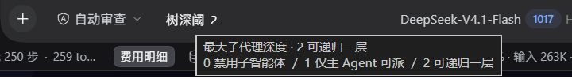

# dsh-subagent-depth

在 DSH 聊天输入栏加一个「树深阈」控件，把**子代理最大递归深度**在 `0 / 1 / 2` 之间切换。

> **这不是新能力。** 递归深度上限是 DeepSeek Harness 内置的（设置 → Subagent → 最大递归深度）。
> 本插件只补一个顺手入口，读写的是同一份配置，与设置页双向一致。

插件一共四件事，每一件都可以单独关掉：

| | 是什么 | 默认 |
|---|---|---|
| **深度控件** | 输入栏那个「子代理 0/1/2」 | 开 |
| **每层配额** | 同一棵树里，1 级最多 5 个、2 级最多 8 个同时运行 | 开（可改数） |
| **委派评审员** | 放行前让另一个模型审一次（allow / ask / deny） | 配了模型才生效 |
| **Consultant（Consultant）** | 复杂委派先问顾问，顾问只出主意，**决定权仍在做事的 Agent** | 关（要手动打开） |

输入栏里的样子（无边框，与旁边的「自动审查」同为 13px，融进工具行）：


点击 chip，菜单**向上**弹出。每一档带一个层级图标（⊘ / 两节点 / 三节点），行有 hover 高亮、当前档带勾、指针变手型：



尺寸与配色不是估的，是从这两个已发布包里的 CSS 抄的：

- `@deepseek-ai/dsh-client-ui-permission-presets` → `PermissionSelect.module.css`（chip 的 `height:28px`、`padding:0 4px 0 8px`、`font-size:13px; font-weight:500; line-height:20px`、`color:var(--dsw-alias-label-secondary)`、hover `var(--dsw-alias-interactive-bg-hover)`）
- `@deepseek-ai/dsh-client-ui-primitives` → `Menu.module.css` + `MenuSurface.module.css`（菜单卡片的 `--dsw-menu-surface-fill`、`--dsw-elevation-prominent`、行高 `min-height:34px`）

## 三档含义

| 值 | 含义 | 效果 |
|---|---|---|
| `0` | 禁用子智能体 | 主 Agent 也不能派子代理 |
| `1` | 仅主 Agent 可派 | 子代理不能再往下派 |
| `2` | 可递归一层 | 子代理可以再派一层 |

**这是上限，不是指令。** 派不派、派几层，仍由 Agent 按任务自己决定；调到 2 不会让它变啰嗦，调到 1 也不会逼它别派。

## 安装

方式一，应用内：插件 → 安装本地目录，选这个包目录。

方式二，命令行（**仅限非 desktop profile**）：

```
dsh plugin --profile <profile> add <本目录绝对路径>
```

> desktop profile 由 Electron 独占管理，CLI 会直接报
> `error: profile "desktop" is managed exclusively by the Electron application`。
> 这种 profile 请在应用内安装。

## 原理

输入栏是插槽化的。这个控件注册到 `conversation.input.left`——composer 工具行左侧的紧凑控件位，
`replaceRisk: none`，与「自动审查」「模型选择」同一排，`order: 10`。

读写不另立存储，而是复用设置页那一套：

```
React <select>  ──change──▶  ConfigFormController.set("maxDepth", n)
                               │
                               ├─ ctx.remote.settings.mutate("subagent",
                               │     [{ op: "set", path: ["maxDepth"], value: n }], revision)
                               │
                               └─ Host: settings.write → configEditor.edit → profile 的 cordis.patch.yml
```

- `configForms` 是 `@deepseek-ai/dsh-client-ui-settings` 提供的服务，本插件只 `inject: ["slots", "locale", "configForms"]`
- 读取靠 `useSyncExternalStore(form.subscribe, form.getSnapshot)`，设置页一改这边立刻跟着变
- 写入带 revision，两边同时改不会静默覆盖，冲突会报错

`maxDepth` 在 schema 里是 `x-cordis.volatile: true`，所以改完立即生效，不需要重启。

## 评审员（可选，默认不启用）

配额只管「几个」，管不了「该不该派」。把评审员接上之后，每次委派在放行前会先问**另一个模型**：

- 设置页填 `reviewerProvider` / `reviewerModel` —— **必须是你已经授权给子智能体的路由**（设置 → Subagent → 允许 Agent 为子智能体选择模型）
- 填 `policy`：你自己对这个项目的分层原则（什么该派、什么该自己干）
- 评审员只会回一个 JSON：`{"decision":"allow|ask|deny","reason":"…"}`
- `allow` 放行 · `ask` 弹给你定 · `deny` 直接拒
- 评审员调用失败、或回不出合法 JSON 时**一律放行**——守卫不能把委派本身弄坏
- `reviewMode` 设成 `off` 可以只保留配额、关掉评审

两者顺序是固定的：**先判配额（便宜、确定），通过了才花一次模型调用去审形状**。

## Consultant（Consultant，可选，默认关闭）

一句话：**顾问只出主意，派活和验收始终由做事的 Agent 自己决定。**

常见的组织方式是「干活的模型 + 一个更会想的模型」：干活的模型觉得某个活难，先问顾问怎么拆、要几个人；顾问给建议，干活的模型**可以不听、可以改人数**，最后按自己的判断派。本插件把这套流程做进工具里。

### 开启后会发生什么

1. **简单任务照旧。** 直接调 `subagent`，插件让**输入栏右侧选的那个主模型**（干活的 CEO 自己）判断难不难；不难就放行，和没装顾问时一样。判断难度没有单独的模型——主模型就是 CEO，再配一个「筛子」只是重复。
2. **复杂任务会被拦下。** `subagent` 返回一条错误，原文形如
   `This delegation looks complex, so subagent was refused before anything started.`
   并提示你改调 `delegate`。
3. **第一步只问不派。** 调 `delegate`，带上你**自己写的** `need`（为什么难、想怎么拆、约束是什么、什么叫完成）和 `prompt`。这一级的顾问回答，**不启动任何子代理**。
4. **第二步由你拍板。** 看完建议，自己写 `plan`：几个人、每人用什么模型、每人的验收标准。再调 `delegate(plan=[...])`，**只有这个 plan 会真的执行**。
   - `plan[].acceptance` 每一条都会变成子代理**必须交回的结构化字段**（`done` / `summary` / `evidence` / `unmet`），交不出来不算完成。
   - `plan[].provider` / `plan[].model` 让每个子代理走不同模型（例如一个 flash 干活、一个 pro 复核）。

5. **`consult` 工具**：干活卡住时随时问顾问，只答疑、不派活，也不能替你验收。

### 配置（只有插件页一个入口）

**插件 → 子代理深度**，页面上有两节：

**配额**（左列是层级，不可改；右列是该层能同时跑几个）：

| 层级 | 是谁 | 上限 |
|---|---|---|
| 0 | 主 Agent（CEO） | 1（固定，不可改） |
| 1 | 主 Agent 直接派的 | 5（可改） |
| 2 | 1 级再往下派的 | 8（可改） |

页面会显示「同时最多 5 个工人 + 2 个顾问 = 15 个（不含 CEO）」。顾问不占每层名额，但**计入全局上限**，并且**只在对应层级真的会有工人时才计入**：

| 深度 | 工人 | 可用顾问 | 全局上限 |
|---|---|---|---|
| 0 | 0 | 0 | **0** |
| 1 | 5 | 0 级 1 个 | **6** |
| 2 | 5 + 8 | 0 级 + 1 级 2 个 | **15** |

没有工人就没有顾问：某一层配额被压到 0 时，这一层的顾问自动不再计数。

> 内置「设置 → 子智能体 → 子智能体并行数量上限」是派生值，由上面这张表决定。改深度（输入栏 chip）、改层级、改顾问，都会自动重算并写回。
> 如果直接在内置页手改这个数字：插件页会显示「内置 X / 应为 Y」并给出「按深度与上表重新计算」按钮——调小时**先压 2 级、再压 1 级**，某层压到 0 时它的顾问一并失效。

**Consultant**：开关、0 级 / 1 级两条路由（点开是这台 DSH 的模型目录，和输入栏右侧模型菜单同一份：加了 Kimi 就出现，删了就没有）、什么时候问。

输入栏的 **树深阈** 只切深度 0/1/2，不显示也不修改顾问设置。

字段对照：

| 字段 | 含义 | 默认 |
|---|---|---|
| `level1` / `level2` | 1 级 / 2 级的并发上限 | 5 / 8 |
| `consultantEnabled` | 总开关。关 = 完全不拦官方派活工具 | `false` |
| `consultant0Provider` / `consultant0Model` | **0 级**顾问：主 Agent 问的那个 | 空 = 不启用 |
| `consultant1Provider` / `consultant1Model` | **1 级**顾问：子代理问的那个 | 空 = 不启用 |
| `consultantMode` | `smart`（先判断难度，难才问）/ `always`（每次派活都问） | `smart` |

> `screenerProvider` / `screenerModel` 已废弃（旧配置里还能留着，不再读取）：判断难度一律用主模型。

两条**独立路由**，可以选不同的模型，选的都是这台 DSH 里**已经配好**的路由——Kimi、Claude、GPT、Gemini、GLM 之类都可以，按任务性质挑：
比如顶层规划用最会做计划的模型，1 级用某个领域专家。

> 兼容性提示：顾问调用**不传 `temperature`**。Kimi K3 只接受默认温度，传 `temperature: 0` 会直接 400
> （`invalid temperature: only 1 is allowed for this model`），所以统一交给各家适配器的默认值。

```yaml
# profile 的 cordis.patch.yml（设置页改的就是这里）
- id: subagent-depth
  config:
    consultantEnabled: true
    consultant0Provider: deepseek-account
    consultant0Model: deepseek-v4-pro      # 顶层顾问
    consultant1Provider: deepseek-account
    consultant1Model: deepseek-flash       # 1 级顾问（可换成领域模型）
    consultantMode: smart
```

### 花费

| 什么时候 | 花什么 |
|---|---|
| 每次委派 | 1 次筛子调用（默认主模型，便宜） |
| 判定为复杂时 | 1 次顾问调用（模型越贵越明显） |
| 评审员开着时 | 再加 1 次评审调用，**和顾问是两笔** |

嫌贵可以：把 `consultantMode` 设为 `smart`（而不是 `always`）、把顾问换成便宜模型、或把 `reviewMode` 设成 `off` 只留顾问。

### 失败时不会卡死

顾问没配、路由写错、调用超时、回的是空话——**一律不拦委派**：`delegate` 会明确说「顾问暂时不可用」，你再带 `plan` 调一次就按自己的判断派。筛子自己失败时按「复杂」处理（宁可多问一次，不放过难任务）。

### 一些限制（诚实写在这里）

- 筛子只读你给的文字，判断可能过严或过松；过严的代价只是多问一次顾问。
- 同一个任务被拒后 10 分钟内再调同一个 `subagent` 会直接拒（不再重复花筛子钱），提示仍然指向 `delegate`。
- `delegate` 是本插件新增的工具，官方 `subagent` / `subagent_fork` 原样保留；顾问关闭时它们完全不受影响。
- 计划里的模型路由必须是 DSH 认得的路由，写错会在启动子代理时报错（此时会如实报告已启动几个）。

## 一个容易踩的坑

`subagent` 之外，`tool-subagent` / `tool-subagent-fork` 也各自有 `maxDepth`，而且**工具级优先**
（官方说明：「如果某个工具单独设置了最大递归深度，以该工具的设置为准」）。
那两行一旦被钉死，设置页和本控件都会失效。

官方 `@deepseek-ai/dsh-base` 的 bundle patch 对这两行**不设** `maxDepth`，所以正常安装不用管；
只有手改过 profile 才需要检查：

```yaml
- id: tool-subagent
  config:
    provider: spawn
    toolName: subagent      # ← 这里不该出现 maxDepth
```

## 兼容性

在 DSH 桌面版 `0.2.1-rc.2` / profile `desktop` 上实机验证。用到的接口：
`ctx.slots`、`ctx.locale`、`ctx.configForms`、`ctx.remote.settings.mutate`、`configEditor`（客户端）；
`ctx.tools`、`ctx.subagents`、`ctx.agents`、`ctx.llm`、`ctx.systemPrompt`（Host）。

Host 半部的工具注册走官方 `dsh-tool-subagent` 自己用的那条路：`agent/created` → `agent.ctx.inject([...])` → `tools.register`。`delegate` / `consult` 是新名字，不和官方的 `subagent` / `subagent_fork` 抢同一个作用域。

## 风险

| 风险 | 说明 | 缓解 |
|---|---|---|
| 客户端 bundle 加载失败 | 写错就整块不渲染 | 组件外包 `ErrorBoundary`，`apply()` 整体 `try/catch`；失败只掉控件，不掉输入栏 |
| API 漂移 | DSH 升级改了服务名 | 只用已确认存在的 API；`inject` 声明硬依赖，缺服务时不激活而不是抛错 |
| 与设置页同时写 | revision 冲突 | 交给 Host 的 revision 校验，不强行覆盖 |
| 默认值 | 官方默认 `maxDepth` 是 `1` | 本插件不改默认值，只做显示与切换 |
| 顾问把任务判难/判易 | 筛子只读文字 | 判难 → 多问一次顾问；判易 → 和没开顾问一样；筛子自己失败按「难」处理 |
| 顾问调用失败 | 模型挂了、路由写错 | 一律降级放行，`plan` 照样能派 |

## 回滚 / 卸载

应用内：插件 → 找到 `dsh-subagent-depth` → 卸载。

命令行（非 desktop profile）：`dsh plugin --profile <profile> remove dsh-subagent-depth`

卸载后：

- 控件消失
- **`maxDepth` 设置保留**（它是 `subagent` 分节的一部分，跟插件在不在无关）
- 若是以本地目录 link 方式装入 profile，`node_modules` 下可能残留一个 junction，需要手工删除：

```powershell
Remove-Item -Path '<profile>\node_modules\dsh-subagent-depth' -Force
```

（本项目验收时确实遇到这个残留，`remove_bundle` 没有清掉它。）

## 目录

```
client.js          浏览器半部：控件本身
index.js           Host 半部：配置、每层配额、委派评审员、Consultant（delegate / consult）
test/consultant.mjs 自测：假 ctx 跑真实 apply()，38 项断言，不碰 DSH
cordis.patch.yml   插入 bundle 行
locale/en.json     插件列表里的标题与描述
locale/zh.json
icon.svg
docs/              README 截图
```

自测（不需要 DSH、不联网）：

```
node test/consultant.mjs
```

它只验证 Host 侧逻辑（注册、闸门顺序、两步协议、配额、深度、降级），不代替真机验收；真机证据在 `VERIFY.md`。

Host 半部主要函数：

| 函数 | 干什么 |
|---|---|
| `installGuard` | `tools/pre-execute` 闸门：配额、评审员、复杂委派拦截 |
| `installConsultant` | 给每个 Agent 的作用域挂 `delegate` / `consult` 与提示语 |
| `runDelegate` | 两步协议：先问顾问（不派），再按 `plan` 派（带模型与 `outputSchema`） |
| `askConsultant` / `needsConsultant` | 顾问与筛子的模型调用，失败一律降级 |

## 关于本项目的来源（免责声明）

本项目的全部内容——代码、README、提交信息、验收记录——由 AI 助手（DeepSeek Harness 中的编码 Agent）
全程编写与实机验证。使用者不写代码，不是程序员，只负责提出需求、判断产品表现、并在关键决策点拍板。

所有技术结论都以实测为准：每一条「PASS」背后都有原始报错原文、文件片段或截图，不是推测。
但**请自行复核**：如果你打算在别的 DSH 版本或生产环境使用，先读一遍 `client.js`（约 340 行，只有一个控件）
和 `index.js`（约 1200 行：配额、评审员、Consultant），确认它在你那里做的正是你想让它做的事。

本项目按 MIT 许可「按原样」提供，不附带任何担保；作者不对因使用本项目造成的任何后果负责。

## 许可

MIT
